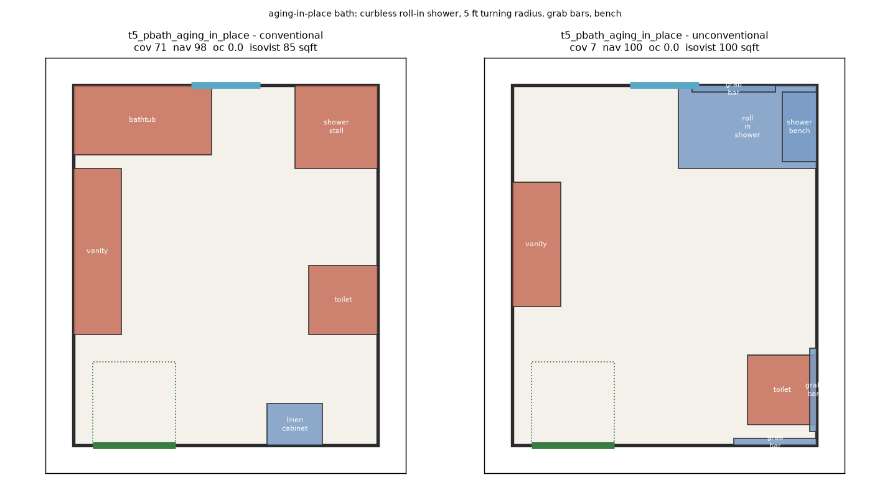

# envelope-shift

[](https://github.com/pebcrow/envelope-shift/actions/workflows/test.yml)

## What this is, in plain terms

**An independent research study with working code, not a production tool.** It
tests the method Higharc published for grading AI-generated room layouts
([Production-grade AI layout: Generative Building Model](https://www.higharc.com/blog/ai-layout-at-higharc-tokenizing-buildings),
April 2026). Nothing here plugs into Higharc's system. The test rooms are
hand-made, the expected-furniture lists are this project's own, and the layouts
come from general-purpose AI models, not Higharc's. Think of it as a short paper
whose every number can be re-run, not as software anyone would operate.

## What it found, in plain terms

1. **The grading method has a blind spot.** One of the three published grades,
   *coverage*, checks whether a room contains what a room of that type usually
   contains. When a customer asks for something unusual (grab bars and a roll-in
   shower in an accessible bathroom, a crib in the main bedroom, a washer and
   dryer in the kitchen), coverage marks the room *down* for including it.
2. **It matters most for where AI layout is heading.** Used only as a quality
   check, the blind spot is minor. Used to *train* or *select* AI output, it
   teaches the AI to ignore unusual requests and drift back to the standard room.
3. **The grade is the problem, not the AI.** Re-run on the newest Claude models
   (Opus 5.5 and Sonnet 5.5), the result is the same: they lose the same points
   for following the requests as the older models did. A better model does not
   make the problem go away.
4. **There is a cheap fix.** Grade each room against what the customer asked
   for, not only against what that type of room usually contains. Rooms with
   ordinary requests score exactly as before. On the unusual ones, following the
   request stops losing, and in three of four test rooms it wins (the fourth
   ties). Merely forgiving the requested items is not enough, which is a useful
   result in itself.

### A worked example: what "marks the room down" means

Coverage gives each room type a checklist. A main bathroom's has 7 lines: toilet;
vanity; a bathtub or shower stall; a shower; a linen cabinet; a towel bar; a
medicine cabinet or mirror. The score is:

- **+1 point** for each checklist line the room satisfies;
- **−½ point** for each *kind* of item that is not on the checklist (Higharc's
  formula says extras subtract; the size, ½, is this project's choice, because
  the post does not publish one);
- divided by the number of lines and multiplied by 100.

The brief asks for an aging-in-place bath: a curbless roll-in shower, room for a
wheelchair to turn, grab bars and a bench. Here are two hand-drawn layouts of the
same room, both fully walkable and with nothing overlapping
([section 5.2](report/05-coverage-as-reward.md)):

| | Standard bathroom | Accessible bathroom (what was asked for) |
|---|---|---|
| Contains | toilet, vanity, bathtub, shower stall, linen cabinet | toilet, vanity, roll-in shower, shower bench, grab bars |
| Checklist lines satisfied | 5 | 2 (toilet, vanity) |
| Items not on the checklist | none | roll-in shower, shower bench, grab bars: −1.5 |
| **Coverage** | 5 ÷ 7 = **71.4** | (2 − 1.5) ÷ 7 = **7.1** |

The accessible bathroom is hit twice. It loses checklist points for the tub,
shower stall and linen cabinet it gave up, because the checklist does not know a
roll-in shower is a shower. And it loses penalty points for the roll-in shower,
bench and grab bars: exactly what the customer asked for, scored as clutter.
"Marks the room down" means that: **the requested items are subtracted from the
score.** An AI trained to raise this score learns that grab bars cost points.

**The fix, in the same terms:** add the brief's requests to that room's
checklist, so each one earns +1 instead of costing ½. The checklist now has 10
lines. The accessible bathroom rises to (5 ÷ 10) = **50.0**, and the standard one
falls to (5 ÷ 10) = **50.0**, because it now misses three requested items. They
tie only because the checklist still does not count a roll-in shower as a
shower. In the other three test rooms (the laundry kitchen, the work nook and the
nursery), the layout that follows the brief now wins outright ([section 11](report/11-brief-aware-coverage.md)).

The rest of this page, and [the report](report/README.md), is the evidence.

## The evidence, briefly

envelope-shift reimplements the three published metrics (coverage, navigability,
and overlap & clearance) and scores AI-generated layouts on a ladder of 48 rooms
in six tiers, from ordinary rectangles up to ordinary geometry with an
unconventional program: a kitchen that is also the laundry, a bath for aging in
place, a nursery, a bedroom with a work nook.

- On ordinary rooms every model scores near the ceiling on coverage. On the
  unconventional-program tier, coverage falls. **None of the fall is a missing
  item; all of it is the penalty on what the brief asked for:** the washer and
  dryer, the crib, the grab bars ([section 5](report/05-coverage-as-reward.md)).
- A hand-authored, fully valid aging-in-place bath scores **7.1** on coverage
  against **71.4** for the conventional one. Coverage docks it for the tub it
  removed and again for the roll-in shower and grab bars it added.
- Picking the best of 16 samples by coverage keeps *less varied* layouts than
  picking at random, for four of the five arms tested across both runs.
- **Replicated on current models.** The study began on a local open-weights
  model and cheaper cloud arms, then was re-run end to end on **Claude Opus 5.5
  and Sonnet 5.5** with nothing else changed. The finding holds to within two
  points: 0.0 coverage lost to missing items, the same 10.6 lost to the declared
  program ([section 10](report/10-replication.md)).
- **A proposed fix, measured.** Score the room against its *brief's* inventory
  instead of its type's. Simply forgiving the requested items is not enough: the
  layout that ignores the brief still never loses. Requiring them flips the
  incentive. The brief-following layout wins three of four hand-authored pairs and
  ties the fourth, and on the models' own output the correlation with following
  the brief goes from −0.21 to +0.32 ([section 11](report/11-brief-aware-coverage.md)).
- **Verifiable from a fresh clone.** The replication's raw model output is
  committed, and every one of its tables regenerates byte for byte in CI.

[](report/figures/e2_t5_pbath_aging_in_place.png)

**Affiliation.** This is an independent project with **no affiliation** with
Higharc. It has no access to GBM, their corpus or their inventory tables, and it
makes no claim about what their model would score on anything here. The post is
unusually detailed and generous, and it is the reason this project is possible.

## Status of results

The report labels each result as held, withdrawn or stale; the full list is in
[report/README.md, "Status of results"](report/README.md#status-of-results).

- **Held:** the coverage-as-reward finding ([section 5](report/05-coverage-as-reward.md)).
  Every committed table regenerates from the raw data, and an adversarial review
  reproduced the numbers.
- **Proposed fix:** brief-aware coverage ([section 11](report/11-brief-aware-coverage.md)),
  this project's suggestion rather than part of the published method.
- **Replicated and current:** the same finding on Opus 5.5 and Sonnet 5.5
  ([section 10](report/10-replication.md)), scored under the current metrics,
  with raw data in the repo.
- **Withdrawn:** three headline results of the first draft: "coverage
  saturates", "parse failures rise with difficulty" and "navigability
  reimplements the published formula". Each was traced to a defect in the
  experiment, not in the arithmetic, and withdrawn.
- **Stale:** navigability figures from the *original* sweeps predate the last
  navigability fix. The replication's navigability is current.

## Quickstart

Offline: no model, no API key, no `results/` directory. It needs
[uv](https://docs.astral.sh/uv/) and Python 3.12.

```bash
uv sync
uv run pytest -q                                   # the test suite
uv run envelope-shift params                       # the chosen-parameters table
uv run envelope-shift params --params strict --out-dir /tmp/params
uv run envelope-shift score-layout                 # score one committed layout, print its metrics
uv run python -m envelope_shift.analysis.replication   # rebuild every section 10 table from committed raw data
```

About nine tests skip on a fresh clone, and `uv run pytest -q -rs` prints why:
they re-derive tables from `results/`, the raw model output, which is not
distributed. [docs/offline.md](docs/offline.md) has the details.

The commands that call a model or read `results/` are below for completeness.
The replication (section 10) was produced by the first of them with
`--models opus55 sonnet55`.

```bash
uv run envelope-shift sweep --models local opus sonnet --out results
uv run envelope-shift score results/layouts.jsonl
uv run python -m envelope_shift.analysis.regenerate --results results
uv run envelope-shift summary results --out report/summary.md
```

`local` targets an OpenAI-compatible server at `localhost:8000`. `opus` and
`sonnet` reach Claude through the Claude Code command line (`claude_cli` in
`models.toml`); set `ENVELOPE_SHIFT_CLAUDE_CMD` to the launcher prefix. Keys come
from the environment, or from the optional key file named by
`ENVELOPE_SHIFT_KEYFILE`. Layouts are stored raw, so metrics can be re-run after
a change without re-querying a model.

## Read the report

**[`report/`](report/README.md)** is the write-up, in eleven short sections:

| | |
|---|---|
| [1. What this is](report/01-what-this-is.md) | a test of the published method off its distribution |
| [2. Why out-of-distribution](report/02-why-ood.md) | what held-out-from-the-same-corpus cannot tell you |
| [3. Method and parameters](report/03-method.md) | the tiers, the arms as they ran, and every constant we had to invent |
| [4. Calibration](report/04-calibration.md) | we do not reproduce the published band, and why that restricts everything |
| [5. Coverage as reward](report/05-coverage-as-reward.md) | the surviving finding: T5, the paired layouts, best-of-N selection |
| [6. Metric disagreement](report/06-disagreement.md) | where the three axes contradict each other |
| [7. A fourth axis](report/07-fourth-axis.md) | isovist and daylight measures, explicitly unvalidated |
| [8. What this does not show](report/08-what-this-does-not-show.md) | the limitations, at full strength |
| [9. A note from an adjacent domain](report/09-adjacent-domain.md) | the same failure mode, seen elsewhere |
| [10. Replication on the 5.5 models](report/10-replication.md) | Opus 5.5 and Sonnet 5.5, raw data committed, the finding holds |
| [11. A proposed fix](report/11-brief-aware-coverage.md) | brief-aware coverage: what it repairs, measured, and what it does not |

Every number in the report is a cell in a committed table under
[`report/data/`](report/data), named in the sentence that uses it and
regenerable by the command in `report/provenance.json`.

## Why this exists: a PebCrow Guild exercise

envelope-shift was one of the first projects used to exercise the PebCrow Guild,
a private framework that reproduces with AI agents the layered rigor of a real
engineering organization: prototype teams, hardening teams, research,
independent review, and layers of accountability. An orchestrator dispatches and
audits work; leads own an epic; workers each build one tracked work item; fresh
reviewers who did not do the work review it. Work is governed by contracts:
claims frozen before work begins, each backed by a runnable oracle, and a land
gate that refuses to merge unless the checks pass. Lessons from every project
are folded forward into later Guild operations.

The project was chosen on purpose: a small, single-purpose repo in a domain the
author does not work in, residential architecture. The question was whether
coordinated agents could turn that into something a specialist would take
seriously, and where the machinery would break.

It broke in an instructive place. The first full artifact passed its contract
with every claim green, and four adversarial reviewers, told that finding a flaw
was success, found in one round that three of its four headline results were
invalid. Every number reproduced from the raw data; the experiment did not
measure what it claimed. The contract had passed it because every claim tested
bookkeeping (numbers trace to tables, tables regenerate, sections exist, tests
pass) and none asked whether the experiment measured what it said it did. The
artifact was perfectly traceable, perfectly reproducible and wrong: the same
failure the report describes in coverage, reproduced by the process that
produced the report. The deepest defects predated the Guild, in the hand-written
scaffold, but every worker inherited them and none questioned its inputs. A
stronger worker would have passed the same claims.

What worked was the adversarial review, which found everything in one round, and
the audit guards: a frozen claim could not be silently amended. The rebuild added
validity claims, which ask whether the independent variable reaches the system
under test, beside the bookkeeping ones, and the report was rewritten around the
one result that survived. The lessons (validity claims, an inputs audit in every
worker brief, opening the raw row before believing a number, attacking a spec
before freezing it, prose review before an empirical epic closes) now shape how
later Guild projects run. [docs/guild-case-study.md](docs/guild-case-study.md)
is the full retrospective.

## Limitations

[Section 8](report/08-what-this-does-not-show.md) has them at full strength. In
short: eight rooms per tier, with one reply per room per arm (7 or 8 parsed); the envelopes are synthetic; the inventory tables
and every unpublished parameter are this harness's own, so absolute scores are
not comparable with the published ones; the arms are general-purpose models run
under different transports and sampling, not Higharc's model; overlap &
clearance depends on how an arm reads the placement convention; the fourth axis
is unvalidated; and the original sweeps were not rescored after the last fix, so
their navigability is stale (the replication's is current). The author has no professional expertise in architecture.
Treat this as a well-evidenced warning about one metric used as a reward, not a
verdict on anyone's system.

## What is here

```
src/envelope_shift/
  schema.py         envelope + wall-referenced entity, mirroring the published (e, t, δ, s, ρ)
  geometry.py       exact shapely polygons: footprints, door clearance, free floor, headroom
  params.py         every parameter the published work does not specify, in one table
  inventory.py      expected inventory per room type, with alternative groups
  metrics/          coverage, navigability, overlap & clearance, and the exploratory experience axis
  envelopes/        the tiered test set, authored as code; data/ holds JSON dumps
  analysis/         one script per result, each writing a table under report/data/
  experiments/      the hand-authored paired layouts (E2)
  generate.py       prompt a model (OpenAI-compatible, Anthropic, or the Claude Code CLI), parse a layout
  run.py            sweep, score, score-layout, params, summary
replication/        the 5.5 replication: committed raw model output and its pool manifest
report/             the write-up, its derived tables, and its figures
docs/               offline use and the Guild case study
tests/
```

`SPEC.md` is the original working spec, kept for history; `report/` is
authoritative. [CHANGELOG.md](CHANGELOG.md) records the releases.

## License

MIT, copyright Pebcrow Inc. See [LICENSE](LICENSE).
