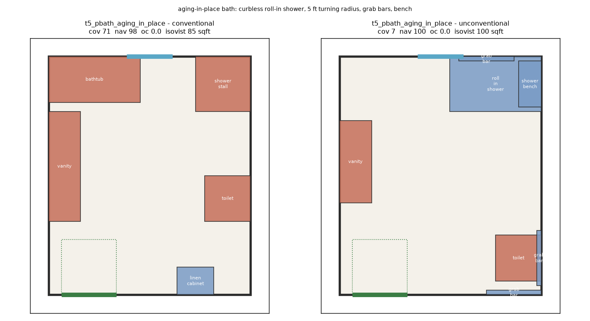
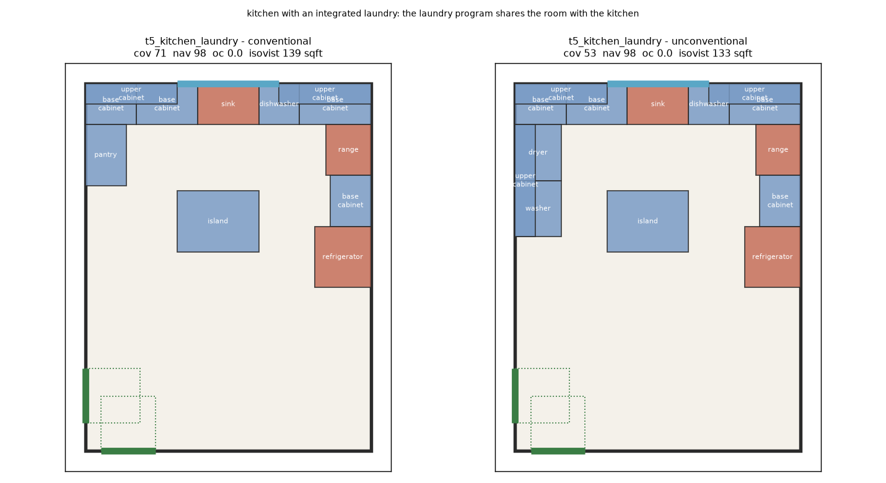
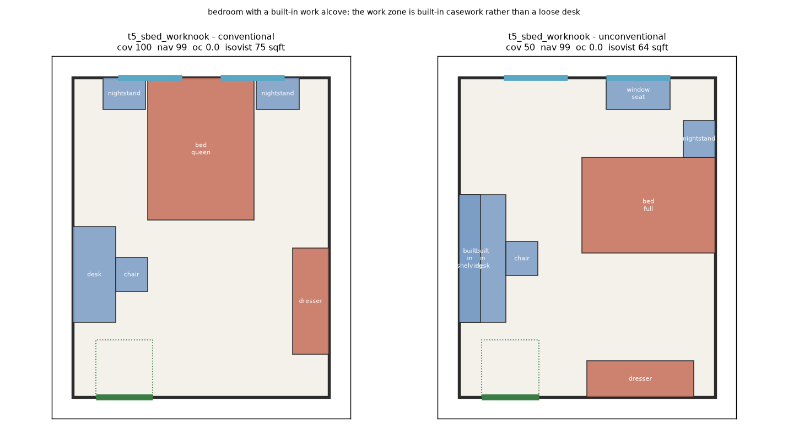
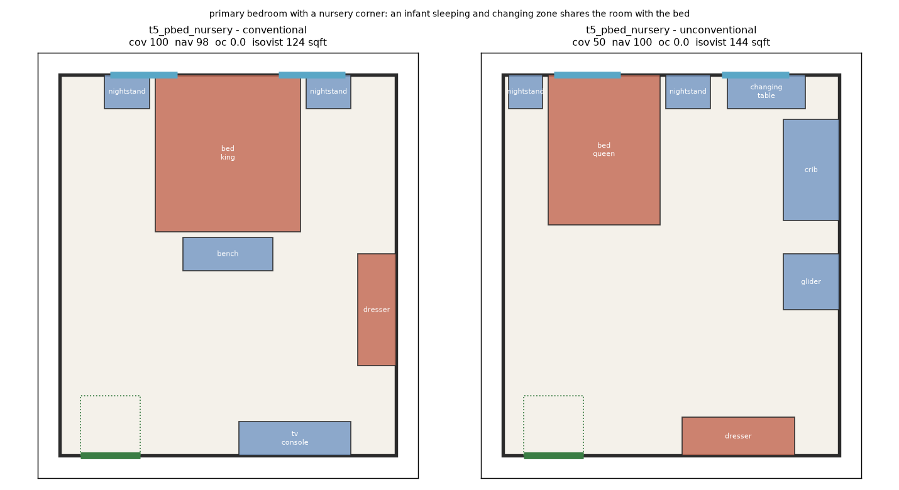
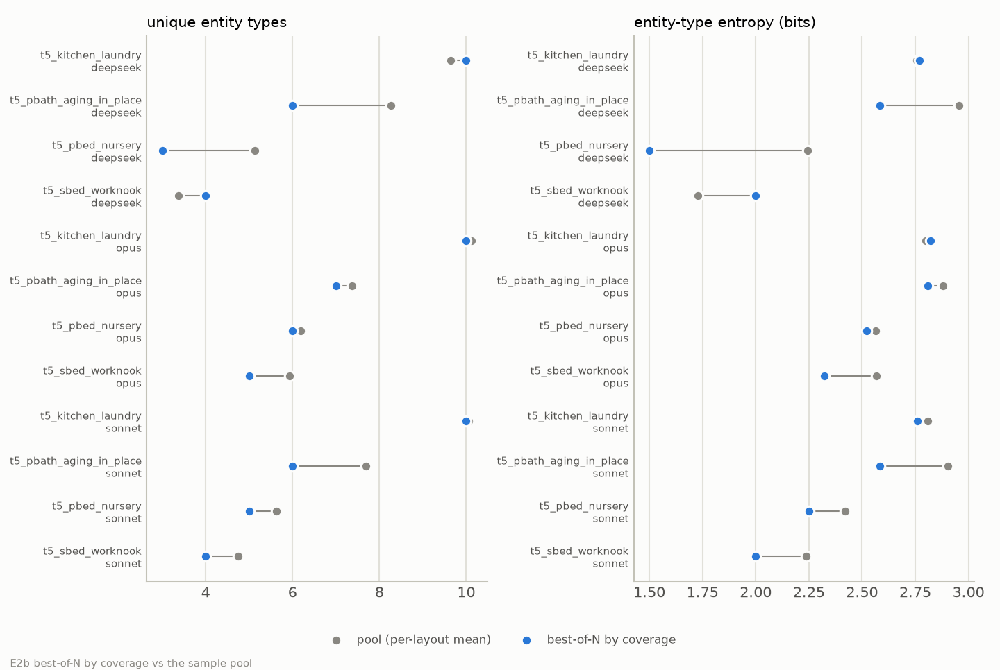

# 5. Coverage as a reward

> **Status: HELD.** This is the finding that survived review. Its coverage,
> selection and hand-authored figures reproduce from the committed tables. One
> figure is STALE: `local`'s navigability on two T5 rooms in 5.1, which comes
> from the sweep and predates the doorway fix
> ([status of results](README.md#status-of-results)).

Coverage asks whether the room contains what a room of that type is supposed to contain, and
as a validity check it is very good. This section is about the other job section 2 named:
a reward has to be right about every layout an optimizer can reach, including the ones a brief
legitimately asks for. It shows one property three ways: in what five model arms emitted for unconventional
briefs, in hand-authored layouts, and in a selection loop.

## 5.1 The brief costs points

With the inventory supplied, every arm's per-tier coverage mean in
[`report/data/e1_degradation.csv`](data/e1_degradation.csv) sits between 93.75 and 100.0 on
every tier from T0 to T4. T5 keeps the geometry ordinary and changes the program: a laundry
kitchen, a bedroom with a work nook, a nursery, a primary bath for aging in place, a
workshop garage. Each T5 envelope carries a brief, and the brief names the program. At T5 the
score falls, and
[`report/data/t5_decomposition.csv`](data/t5_decomposition.csv) says exactly where the points
go. It splits each arm's gap below 100 into four parts: inventory lines left unsatisfied, the
extraneous penalty on types the envelope's own brief declares, the penalty on types that are a
vocabulary variant of an inventory or declared type, and the penalty on everything else.

| arm | rows | clamped | coverage | missing | declared program | synonym | other |
|---|---|---|---|---|---|---|---|
| local | 7 | 0 | 97.6 | 0.0 | 0.0 | 0.0 | 2.4 |
| deepseek | 8 | 0 | 84.7 | 0.0 | 12.2 | 0.0 | 3.1 |
| glm | 7 | 1 | 84.8 | 0.0 | 8.2 | 3.4 | 3.6 |
| sonnet | 7 | 0 | 84.8 | 0.0 | 10.6 | 4.6 | 0.0 |
| opus | 7 | 1 | 77.2 | 0.0 | 10.6 | 9.0 | 3.1 |

The missing column is 0.0 for every arm. Not one point of the T5 fall is an inventory line a
model left out; all of it is the extraneous penalty. The published formula fixes only that
penalty's sign. Its size, half a line per extraneous type, is `coverage_extraneous_penalty`,
a value this harness chose (section 3's table).

The means above do not cover the same rooms. Only `deepseek`'s includes the workshop garage,
where it scores 25.0; the `glm` and `opus` garage rows are clamped at the floor, which the
decomposition cannot split, and `local`'s and `sonnet`'s did not parse.
[`report/data/t5_common_rooms.csv`](data/t5_common_rooms.csv) restricts every arm to the 7
rooms all five have, and its `excluded` column names what each arm lost and why:

| arm | rooms | coverage | missing | declared program | synonym | other |
|---|---|---|---|---|---|---|
| local | 7 | 97.6 | 0.0 | 0.0 | 0.0 | 2.4 |
| deepseek | 7 | 93.2 | 0.0 | 6.8 | 0.0 | 0.0 |
| glm | 7 | 84.8 | 0.0 | 8.2 | 3.4 | 3.6 |
| sonnet | 7 | 84.8 | 0.0 | 10.6 | 4.6 | 0.0 |
| opus | 7 | 77.2 | 0.0 | 10.6 | 9.0 | 3.1 |

On the common rooms the order is roughly inverse to how much of the stated program an arm
furnished, with a tie: `glm` and `sonnet` both score 84.8, from different mixes. The T5
bootstrap intervals in [`e1_degradation.csv`](data/e1_degradation.csv) overlap for most arms,
so read the order as a description of these rooms. `local`
emits almost none of the program and leads, at a cost this table does not see: its
navigability is 0.0 on the laundry kitchen and the sauna bath
([`report/data/e3_disagreement.csv`](data/e3_disagreement.csv)). `opus` places last on its
synonym column, and two of its synonyms name inventory types, not the program. The rows, from
[`report/data/t5_by_envelope.csv`](data/t5_by_envelope.csv):

- **The laundry kitchen.** `glm` and `sonnet` place the washer and dryer the brief asks for
  and score 90.0; with ten inventory lines, each appliance costs 5.0 points. `opus` also calls
  its island a `kitchen_island` (synonym) and adds a `wall_shelf` (other), 5.0 each: 80.0. `deepseek` and `local` place no laundry and
  score 100.0.
- **The work nook.** `sonnet` places a built-in desk and calls its chair a `desk_chair`:
  66.6667. `opus` does the same and adds a wall shelf: 50.0. `deepseek` and `local` place no
  desk and score 100.0.
- **The aging-in-place bath.** `deepseek`, `glm` and `sonnet` place grab bars and a shower
  bench and score 85.7143; `opus` places only grab bars, less of the program, and scores
  92.8571. `local` places neither and scores 100.0.
- **The nursery.** Every arm but `local` places the crib and changing table; `opus` also writes
  its glider as `glider_chair` and scores 50.0 to the others' 66.6667.

The synonym column is a judgement: `analysis/synonyms.toml` states each mapping's evidence and
the candidates it declined. It is also partly a property of this harness, which takes type
names as free text and matches them as strings; a closed-vocabulary decoder like GBM cannot
emit `desk_chair` at all. A reader who rejects a mapping moves its points to the other
column; the missing column does not change.

## 5.2 The same mechanism, hand-authored

To separate the metric from the models, the four T5 rooms in
[`report/data/e2_pairs.csv`](data/e2_pairs.csv) are hand-authored: one conventional and one
unconventional layout per room, each unconventional variant built around the room's brief
rather than around the metric. All eight are valid — navigability at least 97.6 and
overlap/clearance 0.00 everywhere.

| envelope | layout | n | coverage | navigability | overlap/clearance | isovist |
|---|---|---|---|---|---|---|
| t5_kitchen_laundry | conventional | 12 | 70.7 | 97.6 | 0.00 | 139.1 |
| t5_kitchen_laundry | unconventional | 14 | 52.7 | 97.6 | 0.00 | 132.9 |
| t5_sbed_worknook | conventional | 6 | 100.0 | 98.6 | 0.00 | 74.8 |
| t5_sbed_worknook | unconventional | 7 | 50.0 | 98.7 | 0.00 | 63.8 |
| t5_pbath_aging_in_place | conventional | 5 | 71.4 | 98.5 | 0.00 | 85.1 |
| t5_pbath_aging_in_place | unconventional | 7 | 7.1 | 100.0 | 0.00 | 99.9 |
| t5_pbed_nursery | conventional | 6 | 100.0 | 97.8 | 0.00 | 124.3 |
| t5_pbed_nursery | unconventional | 7 | 50.0 | 100.0 | 0.00 | 144.5 |

The conventional layout wins on coverage in all four pairs, and
[`report/data/e2_coverage_gap.csv`](data/e2_coverage_gap.csv) says why, line by line. In the
work nook and the nursery the whole gap is the extraneous penalty on the program the brief
declares: the built-in desk, shelving and window seat, or the crib, changing table and glider,
each cost 16.6667 points, and the unconventional layout misses no inventory line the
conventional one keeps. Only those two pairs match the T5 mechanism: in the kitchen the washer
and dryer cost 5.0 each on top of the pantry line they displace, and in the bath below most
of the gap is missing lines. The synonym map is not applied to these pairs.

The aging-in-place bath is the sharpest: 71.4 against 7.1. The unconventional layout gives up
the bathtub, the separate shower stall and the linen cabinet for a roll-in shower, a shower
bench and grab bars. The bathing, shower and linen lines it gave up each cost 14.2857, most
of the gap; the three fixtures it put in their place each cost 7.1429 more as extraneous
types. The layout is docked for what it removed and again for what it added.

The same layout clears a five-foot turning circle, the geometry a wheelchair needs to reverse
direction; the `turning_circle_clear` column of
[`report/data/e2_pairs.csv`](data/e2_pairs.csv) tests it against the free floor rather than
asserting it. The table tests only the unconventional layout, so the circle is
not a discriminator between the two, and nothing here claims it is. The point is narrower:
none of the three published metrics has a term for what this room is *for*. Navigability is 98.5 and 100.0 and overlap/clearance 0.00 for both; coverage, the one
axis that moves, sees that the accessibility fixtures are there, which is why they cost points.

## 5.3 Selecting on coverage

E2b asks the dynamic question: use the metric to *select*, and see what selection keeps. Each
of `deepseek`, `opus` and `sonnet` draws 16 samples per E2 room at provider-default sampling,
and the highest-coverage parsed sample is kept (the first, on a tie). Not every sample parses, so a
room's pool holds up to 16 parsed samples; the table's `n` column gives each pool's size.
[`report/data/e2b_bestofn.csv`](data/e2b_bestofn.csv), pooled over the four rooms:

| arm | parsed samples | mean selected coverage | pool mean coverage | selected unique types | pool unique types | selected entropy | pool entropy |
|---|---|---|---|---|---|---|---|
| deepseek | 60 | 100.0 | 86.1 | 21 | 43 | 3.98 | 4.55 |
| opus | 64 | 74.9 | 70.4 | 26 | 38 | 4.36 | 4.52 |
| sonnet | 64 | 85.0 | 76.2 | 23 | 33 | 4.11 | 4.43 |

The selected set is one layout per room and the pool is every layout, so the selected set
would carry fewer types and less entropy than the pool under any rule. The same table's
baseline draws one sample per room at random instead, 2000 times with seed 0. For
`deepseek` the selected entropy, 3.98, sits below the random mean of 4.25 and its fifth
percentile of 4.04; for `sonnet`, 4.11 against 4.32 and 4.18. For `opus`, 4.36 against a
random mean of 4.39 is inside the random range: no detectable difference. For two arms of
three, selecting on coverage keeps less varied layouts than chance does.

Ties at the top are common, and the table takes the first. Choosing at random among the tied
samples (same seed and draws, the `tb_` columns) gives 3.88 for `deepseek`, 4.14 for `sonnet`
and 4.35 for `opus`, with 0.002, 0.02 and 0.27 of random selections at or below. The result
survives the tie rule for `deepseek` and `sonnet`; `opus` shows no detectable difference.
Every E2b result is four rooms with one fixed pool per arm; "chance" means resampling that
pool, and those shares are not p-values.

## 5.4 What this does to a reward

A policy-gradient method moves the policy in proportion to how the reward varies across
samples. On the ordinary tiers coverage barely varies, so it carries little signal. On the
tier where it does vary, section 5.1 and section 5.2 show which way it would point: away from the
program the brief asked for, toward the room the inventory table describes. That is not a defect in coverage as
a check; it is what a conformity measure is, asked to reward a brief its table was never
written for. Closing it needs briefs the reward is evaluated
against, not only an inventory, and at least one axis that is not a conformity measure;
section 7 sketches one.
