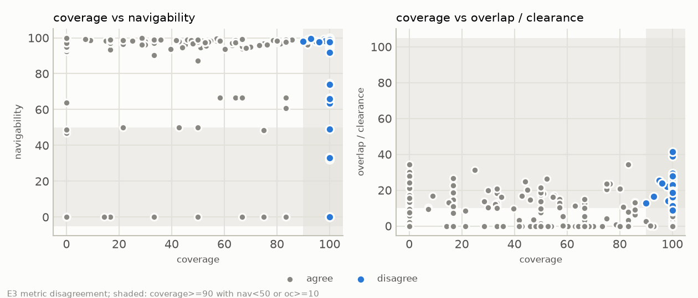

# 6. Where the three metrics disagree

> **Status.** Coverage and overlap & clearance figures here are HELD.
> Navigability figures, and so the `nav<50` flags and the flagged count, are
> STALE: they predate the doorway fix and have not been rescored
> ([status of results](README.md#status-of-results)).

If the three axes were measuring one underlying quantity they would rise and
fall together and a single number would do. They do not, and where they come
apart, one metric reports success about a room another says does not work.

E3 sweeps every parsed layout for an essentially complete inventory (`cov>=90`)
in a room with a material overlap/clearance penalty (`oc>=10`), a room barely
walkable or not walkable at all (`nav<50`), or both, and writes the `reason`
for each to
[`report/data/e3_disagreement.csv`](data/e3_disagreement.csv). Sixty layouts
are flagged, eleven with the `nav<50` tag,
spread across every tier from T0 to T5.
They are not spread evenly across models: `deepseek`, `glm` and `local` account
for all but two, and the two Claude arms contribute one each, which matches
their near-zero overlap & clearance at T0 in section 4.

## 6.1 The clearest case

| envelope | tier | model | coverage | navigability | overlap/clearance |
|---|---|---|---|---|---|
| t0_sbath_5x9 | T0 | glm | 100.0000 | 0.0000 | 12.4476 |

Coverage is 100.0: the scorer found
nothing missing from the expected inventory and nothing extraneous. Navigability
is 0.0 — of the door-to-target paths the harness tries, a body of the configured
radius can walk none. Overlap/clearance is 12.4.

So: every entity the right kind of thing, arranged into a room nobody can cross
— and `t0_sbath_5x9` is a T0 room, a rectangular secondary bath of ordinary
proportions, so envelope difficulty is not an obvious cause. Coverage is not wrong
here. It was asked whether the inventory is satisfied, it is, and it said so.
The trouble is only what happens if coverage is the number that gets optimized,
headlined, or used to pick a candidate layout.

## 6.2 Disagreement is not noise

The same envelope under a different model makes the complementary point:

| envelope | tier | model | coverage | navigability | overlap/clearance |
|---|---|---|---|---|---|
| t0_sbath_5x9 | T0 | deepseek | 100.0000 | 97.2860 | 17.4395 |

Coverage is identical, 100.0, and the room is walkable, navigability 97.3,
while carrying a heavier overlap/clearance penalty, 17.4. Coverage cannot tell
these two rooms apart at all; the other two axes disagree with it and with each
other about which is worse.

That generalizes past this one pair. Of the flagged layouts the large majority
carry only the `oc>=10` tag: complete inventory, walkable room, fixtures
crowding each other. Those are not catastrophes, and that is why they matter:
the ordinary texture of generated layouts, plausible and slightly unlivable, where coverage is silent. The
finding is about *aggregation*. Any summary leaning on coverage reports these rooms as
successes.
