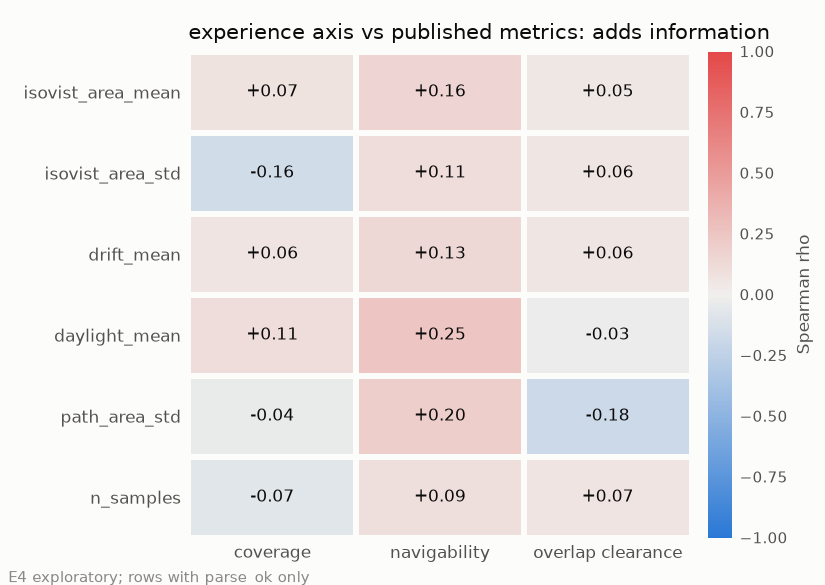

# 7. A fourth axis, and what it is not

The experience axis described here is **unvalidated against human preference**.
No architect, no resident and no user study has ever been shown a pair of
layouts and asked which is better, so nothing below establishes that a higher
experience score means a better room. It is **advisory** — a diagnostic to read
alongside the three published metrics, never a gate and never a reward on its
own. Validating it would need a human-preference study this project does not
attempt.

> **Status.** The correlations against coverage and overlap & clearance are
> HELD; the navigability column is STALE, because it uses sweep navigability
> from before the doorway fix. The isovist values of the hand-authored pairs in
> 7.3 are current ([status of results](README.md#status-of-results)).

## 7.1 What it measures

From a grid of standing positions inside the room, cast rays and summarize what
a person can see and how that changes as they move: the mean and spread of
visible floor area, how far the visible field drifts from where you stand, the
unobstructed window angle, and the variation in visible area along the walk from
the main door to the room's primary target. The implementation is in
`src/envelope_shift/metrics/experience.py`, whose docstring opens with the same
caveat this section does; every parameter it reads is in the section 3 table.

The motivation is the gap section 5 opened. Coverage asks what is in the room,
navigability whether you can cross it, overlap/clearance whether the pieces fit;
none asks what it is like to be in there — the question the aging-in-place bath
was answering when coverage gave it 7.1.

## 7.2 It is near-orthogonal to all three published metrics

Spearman rank correlation of every experience measure against every published
metric, over the parsed layouts of the sweep
([`report/data/e4_correlation.csv`](data/e4_correlation.csv)):

| experience measure | n | vs coverage | vs navigability | vs overlap/clearance |
|---|---|---|---|---|
| exp_isovist_area_mean | 420 | 0.0739 | 0.1570 | 0.0540 |
| exp_isovist_area_std | 420 | -0.1623 | 0.1053 | 0.0565 |
| exp_drift_mean | 420 | 0.0639 | 0.1345 | 0.0562 |
| exp_daylight_mean | 420 | 0.1075 | 0.2487 | -0.0287 |
| exp_path_area_std | 420 | -0.0371 | 0.1996 | -0.1805 |
| exp_n_samples | 420 | -0.0729 | 0.0943 | 0.0657 |

No cell exceeds 0.2487 in absolute value; that largest one is daylight against
navigability, and the next, `exp_path_area_std` against navigability at 0.1996,
is expected rather than interesting — both derive from the same sampled paths,
so it is closer to a sanity check on the implementation than a result.

Near-orthogonality establishes exactly one thing: the axis is **not redundant**.
Whatever it measures, the published three are not already measuring it. It is
**not** evidence that the axis is good — an orthogonal measurement and a
meaningless one are indistinguishable by a correlation table, since noise would
look the same.

## 7.3 The one suggestive signal

The four hand-authored pairs of section 5 carry the only independent opinion in
this project about which layout is better, and it is ours rather than a study's.
Against it, the axis prefers the unconventional layout in two of the four pairs
— [`report/data/e2_pairs.csv`](data/e2_pairs.csv):

| pair | conventional isovist | unconventional isovist |
|---|---|---|
| t5_pbath_aging_in_place | 85.1 | 99.9 |
| t5_pbed_nursery | 124.3 | 144.5 |
| t5_kitchen_laundry | 139.1 | 132.9 |
| t5_sbed_worknook | 74.8 | 63.8 |

The aging-in-place bath is the case section 5 cared about, and the axis ranks it
above its conventional counterpart — the layout coverage scored 7.1 against
71.4. That is the result this section exists to report and the one most at risk
of being oversold: two of four pairs, authored by the same people who wrote the
measure, is an anecdote with a number attached — a reason to run the study, not
a substitute for it.
